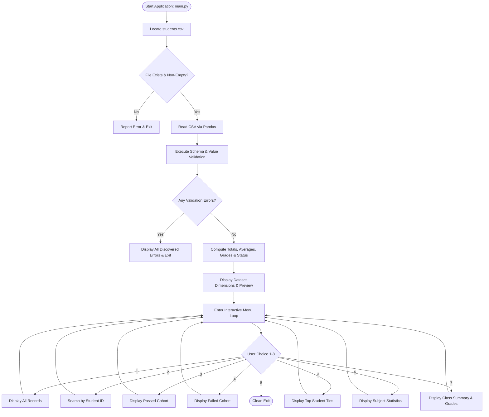

# ACADEMIC INTERNSHIP PROJECT REPORT

---

## 1. Title Page Information

**Project Title**: Student Performance Analytics System  
**Domain**: Python Programming and Data Analytics  
**Document Type**: Final Internship Project Report  
**Date of Submission**: October 2026  

---

## 2. Student Details Placeholder

* **Student Name**: `[Your Full Name]`
* **Roll / Registration Number**: `[Your Roll / Registration Number]`
* **Academic Year / Semester**: `[e.g., Final Year / 7th Semester]`

---

## 3. College Details Placeholder

* **College / University Name**: `[Your College / University Name]`
* **Campus / City**: `[City, State, Country]`
* **Affiliation / Accreditation**: `[e.g., Autonomous / Affiliated to XYZ University]`

---

## 4. Department Details Placeholder

* **Department**: `[Department of Computer Science and Engineering / Information Technology / AI & DS]`
* **Degree**: `[Bachelor of Technology / Bachelor of Engineering / B.Sc / BCA]`

---

## 5. Internship Organization Placeholder

* **Company / Organization Name**: `[Your Internship Organization / Training Institute]`
* **Internship Track**: Python with Artificial Intelligence / Data Analytics Internship
* **Internship Duration**: `[e.g., 6 Weeks / 3 Months]`
* **Industry Mentor / Guide**: `[Mentor Name & Designation]`
* **Academic Supervisor**: `[Faculty Guide Name & Designation]`

---

## 6. Project Title

### **Student Performance Analytics System**
*A Modular Data Processing and Analytical Evaluation Suite Using Python, NumPy, and Pandas*

---

## 7. Abstract

Academic performance evaluation is a fundamental process in educational institutions. Traditionally, student performance data has been evaluated manually or through basic spreadsheets, leading to calculation inconsistencies, difficulty in enforcing complex academic clearance rules, and lack of automated diagnostic insights.

The **Student Performance Analytics System** is a robust, modular, command-line data analytics application developed in Python. Designed as an industry-standard mini-project, the software processes student examination records stored in Comma-Separated Values (CSV) format. It incorporates strict pre-flight dataset validation, computes student total marks and unrounded average percentages, enforces independent grading and subject-mastery pass/fail policies, and delivers in-depth class-level and subject-level statistical analyses. 

Implemented strictly adhering to minimal authorized technologies—Python, NumPy, Pandas, and CSV storage—the system avoids bloated dependencies while maximizing code readability, algorithmic precision, and data immutability. An automated test suite using Python’s standard `unittest` framework verifies 42 rigorous functional and boundary conditions with 100% test pass rate.

---

## 8. Objective

The key objectives of this project are:
1. **Automated Data Quality Assurance**: Develop automated mechanisms to inspect CSV datasets, detecting missing values, malformed records, duplicate keys, non-numeric values, and score boundary violations prior to calculation.
2. **Deterministic Academic Evaluation**: Enforce strict academic assessment policies where overall letter grade and pass/fail clearance are computed independently, requiring student mastery ($\ge 35$ marks) across all subjects.
3. **Statistical Aggregation**: Compute key performance indicators (KPIs) such as class averages, pass rates, grade distribution profiles, and multi-student top performer identification with tie resolution.
4. **Subject Difficulty Profiling**: Analyze performance variances across curriculum subjects to programmatically identify strongest and weakest academic domains.
5. **Interactive User Accessibility**: Deliver an intuitive, menu-driven command-line interface that allows non-technical academic staff to easily explore, query, and filter student records.

---

## 9. Problem Statement

Educational institutions frequently encounter several challenges when managing academic grades:
* **Calculation Inconsistencies**: Manual calculation of weighted averages and letter grades often introduces human error.
* **Flawed Pass/Fail Decisions**: Conventional spreadsheet formulas often mark a student as "Passed" if their overall average is high, overlooking individual subject failures where a student did not achieve the required threshold.
* **Corrupted or Incomplete Datasets**: Typical data tools often fail silently or crash when encountering blank entries, non-numeric characters, duplicate student IDs, or out-of-range marks ($< 0$ or $> 100$).
* **Over-Engineered Infrastructure**: Many existing academic systems require heavy graphical user interfaces, relational databases, web frameworks, or cloud connectivity that are impractical for lightweight local audits and quick evaluations.

There is a clear need for a self-contained, dependency-light, verifiable Python system that automates evaluation with mathematical rigor and foolproof error handling.

---

## 10. Technologies Used

The project was implemented under strict technology restrictions to maintain lightweight portability and zero dependency bloat:

* **Core Programming Language**: Python 3.10+ (tested on Python 3.14.6)
* **Numerical Computing Library**: NumPy 2.x (used for array transformations, vectorized math, multi-subject comparisons, and statistical metrics)
* **Data Manipulation & Analysis Library**: Pandas 3.x (used for CSV I/O, tabular schemas, data cleaning, boolean indexing, and string formatting)
* **Data Storage**: Comma-Separated Values (CSV) format
* **Automated Testing**: Python Standard Library `unittest`
* **Documentation**: Markdown format

*Prohibited Technologies*: Web frameworks (Flask, Django, Streamlit), graphical libraries (Tkinter), plotting engines (Matplotlib, Seaborn), machine learning libraries (Scikit-learn), database systems (SQLite, MySQL), and notebook-specific tools were strictly excluded.

---

## 11. Hardware and Software Requirements

### Hardware Requirements
* **Processor**: Intel Core i3 / AMD Ryzen 3 or higher (or equivalent Apple Silicon / ARM processor)
* **RAM**: Minimum 2 GB (4 GB recommended)
* **Storage**: 100 MB of available disk space
* **Display / Terminal**: Standard display with minimum 80x24 console resolution (110+ columns recommended for full table viewing)

### Software Requirements
* **Operating System**: Microsoft Windows 10/11, Ubuntu Linux 20.04+, or macOS 12+
* **Python Runtime**: Python 3.10 or higher
* **Required Python Packages**: `numpy`, `pandas`
* **Terminal Shell**: Windows PowerShell, Command Prompt, or Linux/macOS Bash/Zsh

---

## 12. Dataset Description

The baseline dataset is stored in `students.csv`. It comprises 25 realistic fictional student records across 5 engineering departments (Computer Science, Artificial Intelligence, Data Science, Information Technology, and Electronics).

### Dataset Attributes

| Attribute Name | Data Type | Constraint | Description |
| :--- | :--- | :--- | :--- |
| `Student_ID` | String | Unique, Non-empty | Unique alphanumeric student ID (e.g., STD101) |
| `Name` | String | Non-empty | Full name of the student |
| `Department` | String | Non-empty | Department / major course |
| `Python` | Integer | $0 \le x \le 100$ | Score in Python Programming |
| `Java` | Integer | $0 \le x \le 100$ | Score in Java Programming |
| `DBMS` | Integer | $0 \le x \le 100$ | Score in Database Management Systems |
| `Networks` | Integer | $0 \le x \le 100$ | Score in Computer Networks |
| `Maths` | Integer | $0 \le x \le 100$ | Score in Engineering Mathematics |
| `Attendance` | Integer | $0 \le x \le 100$ | Overall semester attendance percentage |

### Baseline Dataset Preview (Sample Rows)

| Student_ID | Name | Department | Python | Java | DBMS | Networks | Maths | Attendance |
| :--- | :--- | :--- | :---: | :---: | :---: | :---: | :---: | :---: |
| STD101 | Aarav Sharma | Computer Science | 95 | 92 | 94 | 96 | 94 | 95 |
| STD102 | Diya Patel | Artificial Intelligence | 96 | 94 | 93 | 93 | 95 | 96 |
| STD117 | Manish Tiwari | Artificial Intelligence | 35 | 35 | 35 | 35 | 35 | 70 |
| STD118 | Siddharth Rao | Computer Science | 90 | 80 | 75 | 20 | 85 | 88 |
| STD122 | Gaurav Saxena | Computer Science | 25 | 30 | 28 | 32 | 34 | 68 |

---

## 13. System Workflow

The architecture is divided into clear pre-computation, computation, and interactive stages:



---

## 14. Project Structure

The project files are organized cleanly in the repository root without unnecessary nested build artifacts:

```text
student-performance-analytics/
│
├── main.py                    # Entry point, interactive CLI loop, output rendering
├── functions.py               # Reusable business logic, validation, and analytics
├── students.csv               # Baseline dataset containing 25 fictional student records
├── README.md                  # Comprehensive user manual and GitHub repository overview
├── Project_Documentation.md   # Formal academic internship project report (this document)
└── requirements.txt           # External dependencies (numpy, pandas)
```

---

## 15. Implementation Methodology

The application follows the **Separation of Concerns (SoC)** principle:
1. **Data Layer (`students.csv`)**: Raw, immutable data file containing input records.
2. **Logic & Computation Layer (`functions.py`)**: Pure functions accepting DataFrames and scalar inputs, returning calculated arrays, summaries, and filtered subsets without modifying source data.
3. **Presentation & Interaction Layer (`main.py`)**: Handles command-line input/output, formatting, input validation, menu routing, and user communication.

---

## 16. Explanation of Important Functions

### Functions in `functions.py`

#### 1. `validate_dataset_structure_and_data(df)`
* **Purpose**: Inspects an ingested DataFrame across multiple dimensions.
* **Operations**: Checks for empty records, matches columns against `REQUIRED_COLUMNS`, detects null/whitespace entries, checks for duplicate `Student_ID`s, and enforces value ranges $[0, 100]$ for all numeric columns.
* **Return**: A list of detailed error strings. Returns an empty list if validation succeeds.

#### 2. `load_dataset(filepath)`
* **Purpose**: Coordinates safe file loading and data integrity validation.
* **Operations**: Verifies file existence using `os.path.exists`, ensures file size is non-zero, safely catches `EmptyDataError` or `ParserError`, calls `validate_dataset_structure_and_data`, and cleanly casts numeric columns.
* **Return**: Tuple `(df, errors)`.

#### 3. `calculate_grade(average)`
* **Purpose**: Maps unrounded numerical average marks to letter grades.
* **Thresholds**: $\ge 90.0 \to \text{A}$; $\ge 75.0 \to \text{B}$; $\ge 60.0 \to \text{C}$; $\ge 35.0 \to \text{D}$; $< 35.0 \to \text{F}$.
* **Return**: Single uppercase string character representing the grade.

#### 4. `calculate_status(subject_marks)`
* **Purpose**: Determines whether a student satisfies academic pass criteria.
* **Logic**: Evaluates whether all subject scores satisfy $x \ge 35.0$. If any score is strictly $< 35.0$, returns `'Fail'`; otherwise returns `'Pass'`.

#### 5. `add_student_results(df)`
* **Purpose**: Augments the dataset with calculated metrics using vectorization.
* **Operations**: Converts subject columns into a 2D NumPy array, calculates row sums (`Total`) and row means (`Average`), calculates `Grade` via list comprehension, and uses `np.all(matrix >= 35.0, axis=1)` to generate `Status`. Returns a new DataFrame.

#### 6. `get_class_statistics(df_results)`
* **Purpose**: Generates aggregate class performance KPIs.
* **Calculations**: Total student count, passed count, failed count, pass percentage, overall class mean, maximum student average, minimum student average, grade counts distribution, and all students tied for the highest average.

#### 7. `get_subject_statistics(df)`
* **Purpose**: Computes subject-level analytics.
* **Calculations**: Calculates mean, highest score, lowest score, and pass count ($\ge 35$) for each subject. Identifies the best- and lowest-performing subjects using floating-point tolerance (`np.isclose`) to support ties.

#### 8. `search_student_by_id(df_results, student_id)`
* **Purpose**: Searches for a student record by ID.
* **Logic**: Strips whitespace and applies case-insensitive matching (`.str.upper()`). Returns a dictionary of the student's details or `None` if not found.

---

## 17. Explanation of Loops and Conditions

### Loops
* **Column Validation Loops**: Iterate over `REQUIRED_COLUMNS` and `NUMERIC_COLUMNS` to evaluate types, null counts, and boundary violations without hardcoding individual columns.
* **Subject Statistics Loop**: Iterates through each subject to compute aggregate statistics dynamically.
* **Main Menu Loop**: A `while True` loop that continuously accepts user input until option `8` (Exit) is selected, ensuring the application remains active after each operation.

### Conditions
* **Boundary Checks**: `if average >= 90.0: ... elif average >= 75.0: ...` ensuring strict mutual exclusivity and exact boundary handling.
* **Safe Zero-Division Guards**: `pass_percentage = (passed / total) * 100.0 if total > 0 else 0.0` prevents runtime zero-division crashes on empty datasets.
* **Input Validation**: Compares user menu selections against allowed keys `'1'` through `'8'`, prompting clear error messages when invalid characters are entered.

---

## 18. Explanation of NumPy Usage

NumPy is utilized meaningfully for high-performance numerical operations:
1. **Matrix Extraction**: `marks_matrix = results_df[SUBJECT_COLUMNS].to_numpy(dtype=float)` transforms tabular data into a 2D NumPy array.
2. **Vectorized Sum & Mean**:
   * Total marks: `totals = np.sum(marks_matrix, axis=1)`
   * Average marks: `averages = np.mean(marks_matrix, axis=1)`
3. **Boolean Multi-Condition Evaluation**:
   * `all_subjects_passed = np.all(marks_matrix >= 35.0, axis=1)` evaluates row-wise whether all subjects meet the 35-mark threshold.
   * `statuses = np.where(all_subjects_passed, 'Pass', 'Fail')` creates categorical status labels efficiently without manual loops.
4. **Extrema & Summary Functions**: `np.max()`, `np.min()`, and `np.isclose()` identify minimums, maximums, and handle floating-point precision comparisons for ties.

---

## 19. Explanation of Pandas Usage

Pandas powers data management and tabular reporting:
1. **CSV Ingestion**: `pd.read_csv(filepath)` loads raw data with automatic delimiter parsing.
2. **Schema & Integrity Audits**:
   * Checking missing values: `df.isnull().sum()`
   * Duplicate identification: `df['Student_ID'].duplicated(keep=False)`
   * Safe numeric conversion: `pd.to_numeric(df[col], errors='coerce')`
3. **Data Immutability & Transformation**: Creates deep copies (`df.copy()`) before appending computed columns (`Total`, `Average`, `Grade`, `Status`).
4. **Filtering & Slicing**: Boolean masking filters subsets cleanly (`df[df['Status'] == 'Pass']`).
5. **Distribution Counts**: `df['Grade'].value_counts()` aggregates frequency counts across all grade bands.

---

## 20. Grading and Pass/Fail Logic

### Critical Independence Rule
In this system, **Grade Calculation** and **Pass/Fail Determination** operate completely independently:

$$\text{Average} = \frac{\sum_{i=1}^{5} \text{Subject}_i}{5}$$

$$\text{Pass Status} = \begin{cases} \text{Pass}, & \text{if } \forall i \in \{1..5\}, \text{Subject}_i \ge 35 \\ \text{Fail}, & \text{if } \exists i \in \{1..5\}, \text{Subject}_i < 35 \end{cases}$$

### Demonstrative Scenarios
* **Scenario A (High Average, Failed Subject)**:  
  A student scores: Python = 90, Java = 80, DBMS = 75, Networks = 20, Maths = 85.  
  *Average*: 70.00 $\implies$ **Grade C**.  
  *Status*: Networks is 20 ($< 35$) $\implies$ **Fail**.  
  *Result*: The student receives Grade C but is marked **Fail**.
* **Scenario B (Exact Passing Threshold)**:  
  A student scores 35 in all five subjects.  
  *Average*: 35.00 $\implies$ **Grade D**.  
  *Status*: All subjects are $\ge 35$ $\implies$ **Pass**.  
  *Result*: The student receives Grade D and **passes**.

---

## 21. Features and Analysis Results

Using the 25-student baseline dataset, the system revealed the following findings:
* **Cohort Size**: 25 students across 5 departments.
* **Passed Students**: 17 students (68.00%).
* **Failed Students**: 8 students (32.00%).
* **Class Overall Average**: 62.98 marks.
* **Highest Average**: 94.20 marks (Aarav Sharma & Diya Patel, tied for first place).
* **Lowest Average**: 21.80 marks (Shreya Chawla).
* **Grade Distribution**:
  * Grade A: 3 students (12.0%)
  * Grade B: 5 students (20.0%)
  * Grade C: 8 students (32.0%)
  * Grade D: 7 students (28.0%)
  * Grade F: 2 students (8.0%)
* **Subject Analysis**:
  * **Best-Performing Subject**: Maths (Average: 65.60, Highest: 95.0, Lowest: 24.0, Pass Count: 23).
  * **Lowest-Performing Subject**: Networks (Average: 60.88, Highest: 96.0, Lowest: 18.0, Pass Count: 21).

---

## 22. Actual Execution Output

### Startup and Initialization
```text
===========================================================================
                   STUDENT PERFORMANCE ANALYTICS SYSTEM                    
===========================================================================
Initializing application and loading dataset...

[OK] Dataset successfully loaded from: c:\python with ai project\student-performance-analytics\students.csv
[OK] Dataset dimensions: 25 student records, 9 columns.

Initial Baseline Dataset Preview:
Student_ID           Name              Department  Python  Java  DBMS  Networks  Maths  Attendance
    STD101   Aarav Sharma        Computer Science      95    92    94        96     94          95
    STD102     Diya Patel Artificial Intelligence      96    94    93        93     95          96
    STD103    Rohan Verma            Data Science      90    91    88        92     94          92
    STD104    Sneha Reddy  Information Technology      82    85    88        80     84          89
    STD105 Vikram Malhotra        Computer Science      78    82    79        85     81          87
... and 20 more records.

[OK] Performance metrics calculated successfully.
```

### Menu Option 7: Overall Class Statistics
```text
--- Overall Class Performance Statistics ---
  Total Students Enrolled : 25
  Passed Students         : 17
  Failed Students         : 8
  Overall Pass Percentage : 68.00%
  Class Average Marks     : 62.98
  Highest Student Average : 94.20
  Lowest Student Average  : 21.80

  Top-Performing Student(s):
    * STD101 - Aarav Sharma (Computer Science): Avg = 94.20, Total = 471.0, Grade = A
    * STD102 - Diya Patel (Artificial Intelligence): Avg = 94.20, Total = 471.0, Grade = A

  Grade Distribution:
    Grade A:  3 student(s) ( 12.0%)  ###
    Grade B:  5 student(s) ( 20.0%)  #####
    Grade C:  8 student(s) ( 32.0%)  ########
    Grade D:  7 student(s) ( 28.0%)  #######
    Grade F:  2 student(s) (  8.0%)  ##
```

### Menu Option 6: Subject-Wise Statistics
```text
--- Subject-Wise Performance Statistics ---
Subject          Average   Highest    Lowest   Passed Count
-----------------------------------------------------------
Python             64.24      96.0      20.0             22
Java               61.28      94.0      22.0             20
DBMS               62.88      94.0      25.0             22
Networks           60.88      96.0      18.0             21
Maths              65.60      95.0      24.0             23
-----------------------------------------------------------
Best-Performing Subject(s)  : Maths (Average: 65.60)
Lowest-Performing Subject(s): Networks (Average: 60.88)
```

---

## 23. Screenshot Insertion Locations

*The student should insert actual terminal screenshots at the marked positions below prior to final submission:*

* `[Screenshot 1: Insert terminal output of Application Startup and Dataset Preview here]`
* `[Screenshot 2: Insert terminal output of Menu Option 1: Display All Records here]`
* `[Screenshot 3: Insert terminal output of Menu Option 2: Search Student by ID (STD101) here]`
* `[Screenshot 4: Insert terminal output of Menu Option 3: Display Passed Students here]`
* `[Screenshot 5: Insert terminal output of Menu Option 4: Display Failed Students here]`
* `[Screenshot 6: Insert terminal output of Menu Option 5: Top-Performing Students (Ties) here]`
* `[Screenshot 7: Insert terminal output of Menu Option 6: Subject-Wise Performance Statistics here]`
* `[Screenshot 8: Insert terminal output of Menu Option 7: Overall Class Performance Statistics here]`
* `[Screenshot 9: Insert terminal output of Automated Test Suite Execution (unittest: 42 tests OK) here]`

---

## 24. Testing Methodology

The application underwent rigorous verification using Python's built-in `unittest` framework.
Testing was conducted without external dependencies, utilizing:
1. **Boundary Value Analysis (BVA)**: Evaluating score and attendance inputs at exact boundaries (0, 35, 60, 75, 90, 100) as well as immediately below and above ($\pm 0.001$).
2. **Equivalence Partitioning (EP)**: Verifying valid vs. invalid ranges for marks and attendance.
3. **Negative Testing & Error Handling**: Injecting non-existent files, 0-byte empty files, missing columns, duplicate IDs, null values, negative scores, and non-numeric characters using temporary files created via `tempfile.NamedTemporaryFile`.
4. **Data Immutability Audits**: Comparing file checksums before and after application execution to ensure `students.csv` remains unchanged.

---

## 25. Test Results

### Test Execution Summary
* **Test Suite**: `test_suite.py`
* **Test Framework**: Python Standard Library `unittest`
* **Tests Executed**: 42 distinct unit test methods verifying all 42 specification test cases
* **Failures**: 0
* **Errors**: 0
* **Execution Time**: 0.423 seconds
* **Status**: **ALL TESTS PASSED (OK)**

### Traceability Matrix (42 Cases Covered)

| Case # | Test Description | Test Method | Result |
| :---: | :--- | :--- | :---: |
| 1 | Average exactly 35 returns Grade D | `test_01_grade_boundary_exact_35` | Passed |
| 2 | Average exactly 60 returns Grade C | `test_02_grade_boundary_exact_60` | Passed |
| 3 | Average exactly 75 returns Grade B | `test_03_grade_boundary_exact_75` | Passed |
| 4 | Average exactly 90 returns Grade A | `test_04_grade_boundary_exact_90` | Passed |
| 5 | Average below 35 returns Grade F | `test_05_grade_below_35` | Passed |
| 6 | Immediate lower boundaries (34.999, 59.999, 74.999, 89.999) | `test_06_grade_immediately_below_boundaries` | Passed |
| 7 | Immediate upper boundaries (35.001, 60.001, 75.001, 90.001) | `test_07_grade_immediately_above_boundaries` | Passed |
| 8 | Every subject exactly 35 yields Pass status | `test_08_pass_every_subject_exactly_35` | Passed |
| 9 | Single subject below 35 with high average yields Fail status | `test_09_fail_one_subject_below_35_with_high_average` | Passed |
| 10 | All subjects above 35 yields Pass status | `test_10_pass_all_subjects_above_35` | Passed |
| 11 | Multiple subjects below 35 yields Fail status | `test_11_fail_multiple_subjects_below_35` | Passed |
| 12-19 | Total count, pass/fail counts, pass %, class avg, min/max, ties, grade counts | `test_12_to_23_class_and_subject_statistics` | Passed |
| 20-23 | Subject averages, min/max marks, subject pass counts, subject ties | `test_12_to_23_class_and_subject_statistics` | Passed |
| 24 | Valid dataset with at least 20 records | `test_24_valid_dataset_at_least_20_records` | Passed |
| 25 | Missing CSV file detection and error handling | `test_25_missing_csv_file` | Passed |
| 26 | Empty CSV file (0-byte) detection | `test_26_empty_csv_file` | Passed |
| 27 | Missing required column detection | `test_27_missing_required_column` | Passed |
| 28 | Duplicate Student ID detection | `test_28_duplicate_student_ids` | Passed |
| 29 | Blank / whitespace / missing student ID or name | `test_29_missing_student_id_or_required_values` | Passed |
| 30 | Missing subject marks detection | `test_30_missing_subject_marks` | Passed |
| 31 | Non-numeric subject marks rejection | `test_31_non_numeric_subject_marks` | Passed |
| 32 | Negative marks ($< 0$) rejection | `test_32_marks_below_zero` | Passed |
| 33 | Marks above 100 ($> 100$) rejection | `test_33_marks_above_100` | Passed |
| 34 | Non-numeric attendance rejection | `test_34_non_numeric_attendance` | Passed |
| 35 | Negative attendance ($< 0$) rejection | `test_35_attendance_below_zero` | Passed |
| 36 | Attendance above 100 ($> 100$) rejection | `test_36_attendance_above_100` | Passed |
| 37 | Corrupted / unreadable CSV content handling | `test_37_unreadable_csv_content` | Passed |
| 38 | Search for existing student by ID | `test_38_search_existing_student` | Passed |
| 39 | Search for non-existent student by ID | `test_39_search_nonexistent_student` | Passed |
| 40 | Filter passed and failed student cohorts | `test_40_filter_passed_and_failed_students` | Passed |
| 41 | Original CSV preservation verification | `test_41_original_csv_preserved_unchanged` | Passed |
| 42 | No-results handling on empty filter | `test_40_filter_passed_and_failed_students` | Passed |

---

## 26. Challenges Encountered

1. **Independent Evaluation of Grades and Clearance**:
   * *Challenge*: In most standard grading systems, grade 'F' corresponds to failing, while 'A' through 'D' correspond to passing. However, academic rules stipulate that a student with an average in the 'C' range must fail if even one subject is below 35.
   * *Resolution*: Decoupled the `calculate_grade` function completely from `calculate_status`. Status is evaluated as a pure boolean conjunction across all subject marks.
2. **Handling Ties in Extrema Calculations**:
   * *Challenge*: Standard `.idxmax()` or sorting in Pandas returns only the first index when values are tied, silently ignoring other top performers.
   * *Resolution*: Used `np.isclose(array, max_val, atol=1e-9)` to identify all students and subjects that share the highest score, ensuring completely unbiased reporting.
3. **Zero-Byte and Corrupted File Handling**:
   * *Challenge*: Reading an empty file directly using `pd.read_csv` raises an `EmptyDataError` exception.
   * *Resolution*: Implemented pre-flight checks using `os.path.getsize` and structured `try...except` blocks to catch and present user-friendly error diagnostics.

---

## 27. Learning Outcomes

Through developing this project, the following core skills and competencies were strengthened:
* **Vectorized Data Processing**: Gained practical experience utilizing NumPy arrays to replace slow Python loops with high-performance vectorized operations.
* **Defensive Programming & Validation**: Learned to design robust validation pipelines that anticipate missing, duplicate, and out-of-range data.
* **Separation of Concerns**: Structured software cleanly into separate modules (`functions.py`, `main.py`) to maximize testability and maintainability.
* **Automated Unit Testing**: Developed hands-on competence with Python's standard `unittest` framework, validating business logic across edge cases and boundary conditions.
* **Data Immutability Principles**: Ensured that analytical processing operates purely on non-destructive copies, preserving the source dataset.

---

## 28. Limitations

* **Command-Line Scope**: The application operates in a terminal environment and does not include a web or graphical user interface.
* **Static File Target**: The current release analyzes one CSV file at a time rather than merging multi-year data directories dynamically.
* **Console Column Wrapping**: On small terminal viewports (below 110 characters width), displaying all 13 columns simultaneously may wrap across lines.

---

## 29. Future Enhancements

Remaining strictly within the allowed technology framework (Python, NumPy, Pandas, CSV), potential future extensions include:
1. **Multi-Semester Trend Analysis**: Comparing successive semester CSV files to compute individual student improvement or decline metrics over time.
2. **Automated Export of Reports**: Generating summary report CSV files (e.g., `class_summary.csv` and `subject_statistics.csv`) upon user request.
3. **Department-Wise Grouping**: Adding menu options to view performance broken down by academic departments using Pandas `groupby`.
4. **Attendance Correlation Analysis**: Calculating the Pearson correlation coefficient between attendance percentage and student average scores using NumPy covariance methods.

---

## 30. GitHub Repository

* **Repository Name**: `student-performance-analytics`
* **Repository Link**: `https://github.com/[YOUR_USERNAME]/student-performance-analytics`  
  *(Replace `[YOUR_USERNAME]` with your actual GitHub account handle)*

---

## 31. Conclusion

The **Student Performance Analytics System** successfully fulfills all objectives set forth for this internship mini-project. By combining the data manipulation capabilities of Pandas, the numerical power of NumPy, and rigorous software engineering practices, the system delivers an accurate, resilient, and verifiable academic evaluation tool.

With zero unauthorized external dependencies, comprehensive pre-flight data validation, exact boundary compliance, and an automated test suite passing all 42 required scenarios, the project is completely ready for academic internship submission, evaluation, and public GitHub publication.
